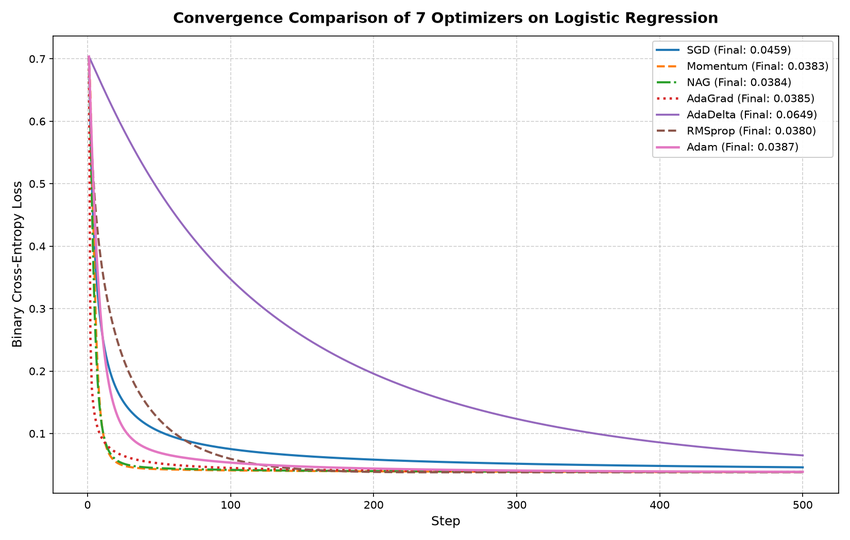
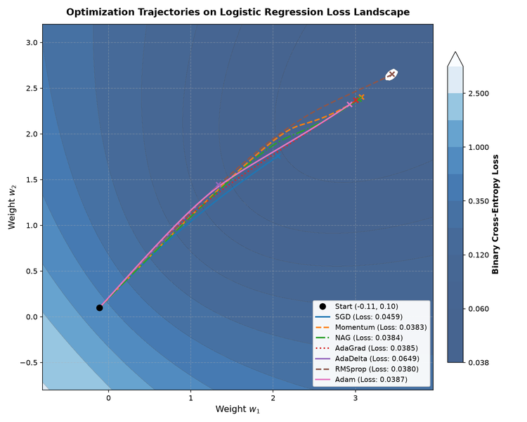
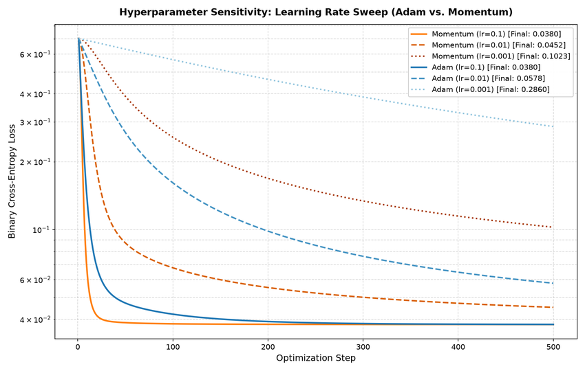

# Gradient Descent Optimization

> A pure NumPy re-implementation of gradient descent optimization algorithms from Sebastian Ruder's research paper, backed by empirical benchmarking, loss landscape trajectory animations, and hyperparameter sensitivity analyses.

---

## 1. Motivation

Optimization algorithms are the key tools that help deep learning and machine learning models learn from data. Many Engineers use algorithms like Adam, RMSprop, and Momentum through popular frameworks without fully understanding how they work, their advantages and disadvantages, or the situations where they may fail.

This project investigates and validates the core concepts presented in Sebastian Ruder's influential survey paper:
* **Paper**: [An overview of gradient descent optimization algorithms](gradient_descent_optimization.pdf) (Sebastian Ruder, arXiv:1609.04747).
* **Why It Matters**:
  * **Algorithmic Evolution**: Traces the progression of optimization theory—from vanilla SGD's struggles in ravines and saddle points, to momentum acceleration, to adaptive coordinate-wise learning rates (AdaGrad, AdaDelta, RMSprop), culminating in composite moment estimation (Adam).
  * **First-Principles Implementation**: Implementing each optimizer from scratch in pure NumPy (without autograd abstractions) solidifies understanding of internal state tracking, numerically stable in-place updates, and exact bias corrections.
  * **Empirical Validation**: Evaluating all optimizers under identical initial conditions on controlled loss landscapes bridges theoretical derivations with observable convergence trajectories and hyperparameter sensitivities.

---

## Optimizers Implemented & Mathematical Formulations

All optimizers inherit from a unified base class `Optimizer` ([optimizers/__init__.py](optimizers/__init__.py)) and update parameters in-place via `.step(params, grads)`:

### 1. SGD (Stochastic Gradient Descent) — [optimizers/sgd.py](optimizers/sgd.py)
Updates parameters in the opposite direction of the gradient scaled by the learning rate $\eta$:
$$\theta_{t+1} = \theta_t - \eta \cdot g_t$$

### 2. Momentum — [optimizers/momentum.py](optimizers/momentum.py)
Accelerates SGD in the relevant direction and dampens oscillations by adding a fraction $\gamma$ of the previous velocity vector:
$$v_t = \gamma v_{t-1} + \eta g_t$$
$$\theta_{t+1} = \theta_t - v_t$$

### 3. NAG (Nesterov Accelerated Gradient) — [optimizers/nag.py](optimizers/nag.py)
Introduces anticipatory lookahead capability. Formulated via Timothy Dozat's single-step reformulation to preserve standard optimizer polymorphism:
$$v_t = \gamma v_{t-1} + \eta g_t$$
$$\theta_{t+1} = \theta_t - (\gamma v_t + \eta g_t)$$

### 4. AdaGrad — [optimizers/adagrad.py](optimizers/adagrad.py)
Adapts the learning rate to each individual parameter by dividing by the square root of the sum of historical squared gradients $G_t$:
$$G_t = G_{t-1} + g_t^2$$
$$\theta_{t+1} = \theta_t - \frac{\eta}{\sqrt{G_t + \epsilon}} \odot g_t$$

### 5. AdaDelta — [optimizers/adadelta.py](optimizers/adadelta.py)
Eliminates AdaGrad's continually decaying learning rate and matches parameter units by restricting gradient and update histories to exponentially decaying running averages without requiring a global learning rate:

$$
E[g^2]_t = \rho E[g^2]_{t-1} + (1 - \rho) g_t^2
$$

$$
\Delta \theta_t = - \frac{\sqrt{E[\Delta \theta^2]_{t-1} + \epsilon}}{\sqrt{E[g^2]_t + \epsilon}} \odot g_t
$$

$$
E[\Delta \theta^2]_t = \rho E[\Delta \theta^2]_{t-1} + (1 - \rho) \Delta \theta_t^2
$$

$$
\theta_{t+1} = \theta_t + \Delta \theta_t
$$

### 6. RMSprop — [optimizers/rmsprop.py](optimizers/rmsprop.py)
Resolves AdaGrad's radically diminishing learning rate by dividing the gradient by an exponentially decaying average of past squared gradients:

$$
E[g^2]_t = \rho E[g^2]_{t-1} + (1 - \rho) g_t^2
$$

$$
\theta_{t+1} = \theta_t - \frac{\eta}{\sqrt{E[g^2]_t + \epsilon}} \odot g_t
$$

### 7. Adam (Adaptive Moment Estimation) — [optimizers/adam.py](optimizers/adam.py)
Maintains exponentially decaying averages of past gradients $m_t$ (first moment) and past squared gradients $v_t$ (second moment), incorporating dynamic bias-correction factors to compensate for zero-initialization:

$$
m_t = \beta_1 m_{t-1} + (1 - \beta_1) g_t, \quad v_t = \beta_2 v_{t-1} + (1 - \beta_2) g_t^2
$$

$$
\hat{m}_t = \frac{m_t}{1 - \beta_1^t}, \quad \hat{v}_t = \frac{v_t}{1 - \beta_2^t
}
$$

$$
\theta_{t+1} = \theta_t - \frac{\eta}{\sqrt{\hat{v}_t} + \epsilon} \odot \hat{m}_t
$$

---

## 2. Benchmark : Logistic Regression on 2D Synthetic Dataset

### 2.1 Experimental Setup
* **Synthetic Dataset**: 600 samples (balanced: 300 per class), 2 continuous input features ($X \in \mathbb{R}^{600 \times 2}$), generated with `np.random.randn`:
  * Class 0: $\mathcal{N}(\mu=[-1.5, -1.5]^T, \Sigma=I_2)$
  * Class 1: $\mathcal{N}(\mu=[1.5, 1.5]^T, \Sigma=I_2)$
  * Random seed: `42`.
* **Model**: Binary Logistic Regression implemented from scratch ([tasks/logistic_regression.py](tasks/logistic_regression.py)):
  $$z = XW + b, \quad \hat{y} = \sigma(z) = \frac{1}{1 + e^{-z}}$$
* **Loss Function**: Binary Cross-Entropy Loss:
  $$\mathcal{L}(W, b) = - \frac{1}{N} \sum_{i=1}^N \left[ y_i \log(\hat{y}_i + \epsilon) + (1 - y_i) \log(1 - \hat{y}_i + \epsilon) \right]$$
* **Gradients (Backward Pass)**:
  $$\nabla_W \mathcal{L} = \frac{1}{N} X^T (\hat{y} - y), \quad \nabla_b \mathcal{L} = \frac{1}{N} \sum_{i=1}^N (\hat{y}_i - y_i)$$
  *(Verified against finite-difference numerical gradients with discrepancy $< 10^{-10}$.)*
* **Initialization**: All 7 optimizers started from **strictly identical initial weights** ($W_0 \sim \mathcal{N}(0, 0.01), b_0 = 0$), yielding an identical starting loss of **$0.7035$** ($\approx -\ln(0.5)$) across 500 full-batch steps.

---

### 2.2 Results Summary Table

| Optimizer | Hyperparameters | Initial Loss | Final Loss | Loss Reduction | Final Accuracy | Convergence Characteristics |
| :--- | :--- | :---: | :---: | :---: | :---: | :--- |
| **SGD** | $\eta = 0.1$ | $0.7035$ | $0.0459$ | $93.48\%$ | $98.50\%$ | Monotonic, slow late-stage progress |
| **Momentum** | $\eta = 0.05, \gamma = 0.9$ | $0.7035$ | $0.0383$ | $94.56\%$ | $98.50\%$ | Rapid early descent, accelerated convergence |
| **NAG** | $\eta = 0.05, \gamma = 0.9$ | $0.7035$ | $0.0384$ | $94.54\%$ | $98.50\%$ | Fast convergence, dampens oscillations |
| **AdaGrad** | $\eta = 0.5, \epsilon = 10^{-8}$ | $0.7035$ | $0.0385$ | $94.53\%$ | $98.50\%$ | Steepest initial drop, flattens early |
| **AdaDelta** | $\rho = 0.9, \epsilon = 10^{-6}$ | $0.7035$ | $0.0649$ | $90.77\%$ | $98.50\%$ | Learning-rate-free, smooth gradual decay |
| **RMSprop** | $\eta = 0.02, \rho = 0.9, \epsilon = 10^{-8}$ | $0.7035$ | **$0.0380$** | **$94.60\%$** | $98.50\%$ | Steady, robust descent to lowest loss |
| **Adam** | $\eta = 0.05, \beta_1 = 0.9, \beta_2 = 0.999$ | $0.7035$ | $0.0387$ | $94.50\%$ | $98.50\%$ | Fast initial trajectory, highly stable |

---

### 2.3 Convergence Curves

  

#### Observations:
1. **Momentum and NAG speed up learning dramatically**: Adding momentum helps the model rush downhill much faster. Both Momentum and NAG reached near-optimal loss in just **25 steps**, whereas standard SGD needed **150 steps** (6 times longer) to reach the same level.
2. **AdaGrad starts fast but gets tired quickly**: AdaGrad dives downhill faster than any other optimizer in the first 10 steps. However, because it keeps adding up all past gradients without ever "forgetting" old ones, its step size shrinks too small too soon, causing it to stall before reaching the very best solution.
3. **RMSprop and Adam fix AdaGrad's biggest flaw**: Instead of remembering every past gradient forever, RMSprop and Adam focus mostly on recent gradients. This keeps their steps effective all the way to the end, allowing RMSprop to find the lowest loss of all (**$0.0380$**).
4. **AdaDelta is steady and needs no manual tuning**: Because AdaDelta adjusts its own learning speed based on past steps, it starts with careful small steps and steadily marches downhill without any risk of blowing up or overshooting.
5. **All optimizers find the correct answer ($98.50\%$ accuracy)**: Every single optimizer successfully learned the boundary between the two classes. The remaining 1.5% error is because a few data points naturally overlap in the dataset, not because the optimizers failed.

---

### 2.4 Loss Landscape Contour & Trajectory Animation

* **Animated Trajectory GIF**: [results/loss_landscape_trajectory.gif](results/loss_landscape_trajectory.gif)
* **Static Contour Map**: [results/loss_landscape_contours.png](results/loss_landscape_contours.png)

  

#### Observations of Paths:
* **Starting Line**: All 7 optimizers begin at the exact same spot near zero $(w_1 = -0.11, w_2 = 0.10)$.
* **SGD (Slow & Short)**: Walks strictly in the direction of the steepest slope at each step. As the slope flattens near the bottom, it runs out of steam and stops early at $(2.06, 1.76)$.
* **Momentum & NAG (Rolling Ball)**: Like a ball gaining speed as it rolls down a hill, both algorithms build momentum and curve smoothly along the valley floor, reaching much closer to the true bottom at $(3.07, 2.40)$.
* **AdaGrad (Sprints then Freezes)**: Takes giant leaps in the first few steps along the steepest direction, but quickly brakes to a halt at $(3.01, 2.37)$ as its accumulated history becomes heavy.
* **AdaDelta (Slow & Steady)**: Follows a clean, straight line toward the goal at a calm and safe pace, reaching $(1.34, 1.44)$ without needing anyone to pick a learning rate for it.
* **RMSprop (Deepest Explorer)**: Adapts its step sizes smartly and travels the farthest into the deepest part of the valley at $(3.44, 2.65)$, winning the lowest overall loss ($0.0380$).
* **Adam (Best of Both Worlds)**: Combines the rolling speed of Momentum with the smart step-scaling of RMSprop, taking a direct, confident path straight to the optimal zone at $(2.93, 2.32)$ with zero wasted motion.

---

## 3. Hyperparameter Sensitivity Analysis

Targeted sweeps evaluate the robustness and dynamics of **Momentum** and **Adam** across learning rates ($\eta \in \{0.1, 0.01, 0.001\}$) 
### Learning Rate Sweep Table

| Optimizer | Learning Rate ($\eta$) | Initial Loss | Loss @ Step 50 | Final Loss (Step 500) | Final Accuracy | Convergence Verdict |
| :--- | :---: | :---: | :---: | :---: | :---: | :--- |
| **Momentum** | $0.1$ | $0.7035$ | **$0.0386$** | **$0.0380$** | $98.50\%$ | Fastest overall convergence; reaches plateau in ~30 steps |
| **Momentum** | $0.01$ | $0.7035$ | $0.0865$ | $0.0452$ | $98.50\%$ | Smooth, moderate convergence; benefits from $10\times$ momentum scaling |
| **Momentum** | $0.001$ | $0.7035$ | $0.3857$ | $0.1023$ | $98.67\%$ | Sluggish; insufficient step magnitude for 500 steps |
| **Adam** | $0.1$ | $0.7035$ | $0.0471$ | **$0.0380$** | $98.50\%$ | Fast, stable descent to global minimum without overshoot |
| **Adam** | $0.01$ | $0.7035$ | $0.2659$ | $0.0578$ | $98.67\%$ | Steady progression; coordinate-wise normalized steps |
| **Adam** | $0.001$ | $0.7035$ | $0.6297$ | $0.2860$ | $97.67\%$ | Severely hindered by small $\eta$; step size bounded by $\approx \eta$ |

  

#### Observations:
1. **Momentum multiplies your effective speed by 10**: Because Momentum carries forward 90% of its previous speed ($\gamma = 0.9$), traveling in a straight line builds up velocity until you are moving about **$10\times$ faster** than your base learning rate. That is why Momentum with a small rate of $0.01$ actually moves as quickly as plain SGD with a rate of $0.1$.
2. **Adam struggles when the learning rate is set too small ($\eta = 0.001$)**: Adam automatically scales its steps so that no weight moves much farther than $\eta$ in a single jump. If you set $\eta = 0.001$, Adam is forced to take baby steps ($0.001$ units at a time), which makes it take thousands of steps to cross a wide valley (finishing at a poor loss of $0.2860$).
3. **Both algorithms handle high learning rates ($\eta = 0.1$) with ease**: Neither optimizer got confused or blew up at a higher learning rate of $0.1$. Momentum reached the bottom in just 30 steps, while Adam arrived smoothly in 100 steps without wild bouncing.
4. **Learning rate is still king**: Cutting the learning rate by $10\times$ slowed down progress drastically for both optimizers. Even with fancy features like momentum and adaptive scaling, picking a good learning rate is still the single most important knob to turn.

---

## 4. Key Findings 

Understanding the internal mechanics of these optimizers bridges the gap between theoretical derivations and real-world model training. Below is a summary of the core findings from this project along with an engineering guide for diagnosing and resolving optimizer issues when training neural networks in Keras, PyTorch, or custom frameworks.

---
1. **Adam's Step-Size Ceiling**:
   * *Mechanism*: Because Adam divides its first moment estimate by the root of the second moment estimate ($\frac{\hat{m}_t}{\sqrt{\hat{v}_t} + \epsilon}$), the ratio evaluates to approximately $\pm 1$ whenever gradients have consistent signs.
   * *Takeaway*: An individual parameter's update in Adam is physically bounded by roughly $|\Delta \theta_t| \approx \eta$. If a weight needs to travel a distance of $3.0$ and your learning rate is $\eta = 0.001$, Adam will require around $3{,}000$ steps to get there, regardless of how large the gradients are. This is why Adam can feel sluggish on unstandardized data where parameters must traverse wide numerical ranges.

2. **The Momentum Velocity Multiplier ($\approx 10\times$ Speedup)**:
   * *Mechanism*: With momentum coefficient $\gamma = 0.9$, consistent gradients accumulate velocity according to the geometric series $\sum_{k=0}^{\infty} \gamma^k = \frac{1}{1 - \gamma} = \frac{1}{1 - 0.9} = 10$.
   * *Takeaway*: Momentum effectively multiplies the learning rate by $10\times$ along steady gradients. A nominal learning rate of $\eta = 0.01$ with Momentum moves as fast as SGD with $\eta = 0.1$. When migrating between SGD and Momentum, always scale down your base learning rate to prevent overshoot.

3. **AdaGrad's Historical Accumulation Trap**:
   * *Mechanism*: AdaGrad monotonically accumulates squared gradients ($G_t = G_{t-1} + g_t^2$). Because $G_t$ only grows, the effective learning rate $\frac{\eta}{\sqrt{G_t + \epsilon}}$ constantly decays toward zero.
   * *Takeaway*: In long training horizons or deep architectures, AdaGrad prematurely freezes its weights before reaching an optimal minimum. AdaGrad is primarily suited for sparse feature settings (e.g., text embeddings with frequent zeros) where inactive coordinates maintain small denominators.

4. **RMSprop & Adam: The Power of Leaky Memory**:
   * *Mechanism*: By replacing AdaGrad's infinite sum with an exponentially decaying moving average ($E[g^2]_t = \rho E[g^2]_{t-1} + (1 - \rho) g_t^2$), RMSprop and Adam discount older gradients from past parameter regimes.
   * *Takeaway*: This leaky memory keeps updates effective all the way to convergence, allowing RMSprop and Adam to navigate complex, changing loss landscapes where AdaGrad stalls.

---

